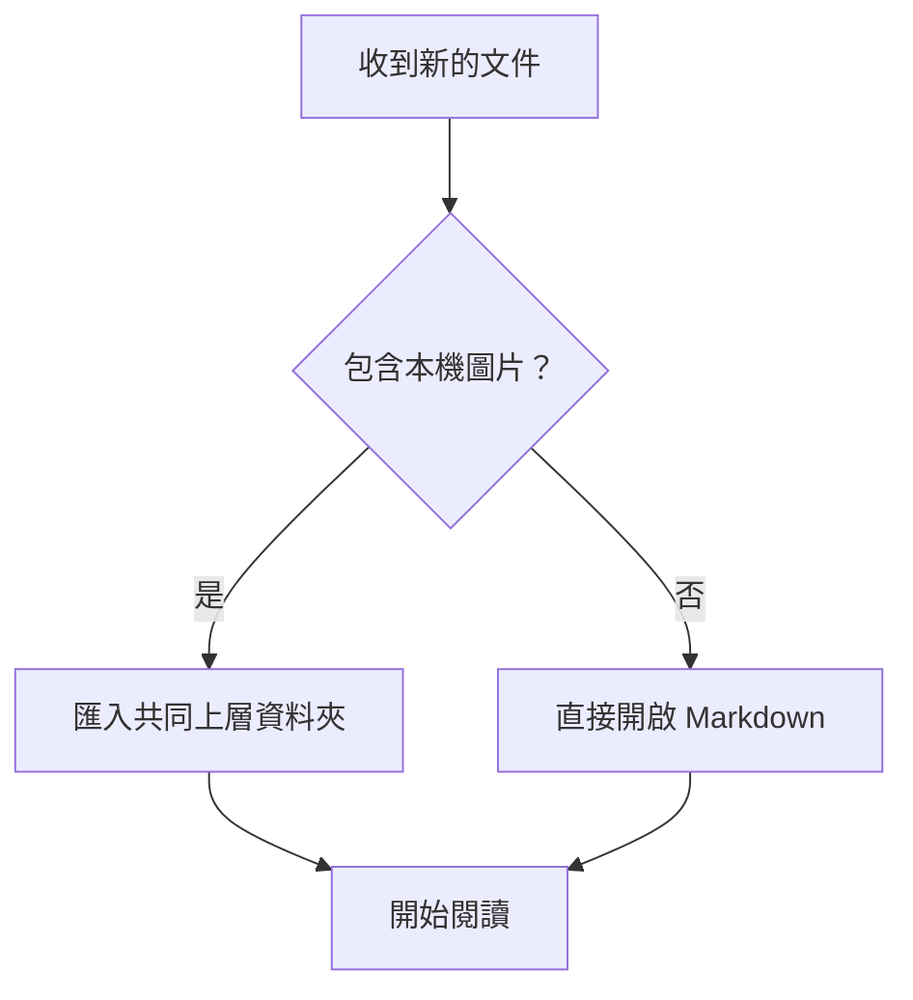
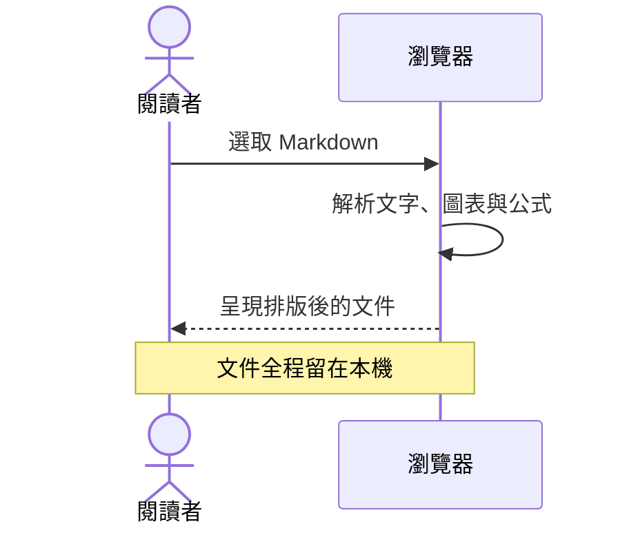

# 把複雜，說得簡單。

流程、對話與數學，都可以成為文件的一部分。這裡的圖表與公式在離線狀態也能完整呈現。

## 流程圖

## 時序圖

## 行內公式

畢氏定理 $a^2 + b^2 = c^2$，也可以跟一般文字自然地放在一起。

## 區塊公式

常態分布的機率密度函數：

$$
f(x) = \frac{1}{\sigma\sqrt{2\pi}}\exp\left(-\frac{(x-\mu)^2}{2\sigma^2}\right)
$$

矩陣也可以清楚呈現：

$$
A = \begin{bmatrix} 1 & 2 \\ 3 & 4 \end{bmatrix}, \qquad \det(A) = -2
$$

## 本機圖片

以下是隨附的本機 SVG 圖片，匯入整個資料夾後也能使用相同的相對路徑。

[回到閱讀指南](./開始閱讀.md) · [查看表格筆記](./表格筆記.md)
