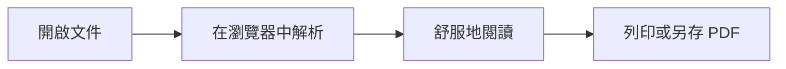

# 好的文件，值得好好閱讀。

歡迎來到 **墨閱 Inkread**，一個讓文字沉澱、讓想法清晰的 Markdown 閱讀空間。從一份筆記到一張複雜的表格，都能以舒服的樣子，呈現在你眼前。

> **簡單開啟，安心閱讀。**
> 拖入你的 `.md` 檔案，或貼上一段文字。所有內容都在瀏覽器內處理，離線時也能自在使用。

## 為閱讀，留一點空間

我們相信，好的排版會讓資訊更容易理解。適當的留白、清楚的層次，以及剛剛好的字級，讓你把注意力留給內容。

你可以從左側開啟文件，用右側目錄快速前往章節，也可以調整字級或切換深色模式，找到自己的閱讀節奏。

## 讓表格，一目瞭然

從每週進度到專案規劃，表格裡的每一筆資訊都值得被清楚看見。

| 功能 | 閱讀體驗 | 支援狀態 |
| :--- | :--- | :---: |
| 文件排版 | 清楚的標題層次、舒適的中文行距 | ✓ 已就緒 |
| 表格呈現 | 隔行底色、欄位對齊、寬表獨立捲動 | ✓ 已就緒 |
| 程式碼 | 語法上色與一鍵複製 | ✓ 已就緒 |
| 流程圖與公式 | Mermaid 圖表、LaTeX 數學公式 | ✓ 已就緒 |
| 本機圖片 | 匯入資料夾，自動對應相對路徑 | ✓ 已就緒 |
| 離線閱讀 | 解壓縮即可開啟，無需連線 | ✓ 已就緒 |

*小提示：遇到比較寬的表格，可以在表格區域左右捲動。*

## 從文字，到清楚的想法

Markdown 讓你用簡單的符號，整理有條理的內容。

### 寫下重點

- 用 **粗體** 標示重要資訊，用 *斜體* 補充語氣。
- 用 `行內程式碼` 記錄檔名或指令。
- 用清單整理思緒，讓下一步更加明確。
- 已完成的想法，也可以用 ~~刪除線~~ 留下軌跡。

### 整理待辦

- [x] 找到一個舒服的閱讀空間
- [x] 試試看表格與程式碼
- [ ] 帶入自己的第一份 Markdown

### 保留程式碼的原貌

```javascript
// 給閱讀，一個簡單的開始。
const document = {
  title: '我的第一份筆記',
  format: 'Markdown',
  staysOnYourDevice: true,
};

console.log(`開始閱讀：${document.title}`);
```

## 讓流程與公式，也說得清楚

用 Mermaid 把過程畫出來，讓每一步都更直覺。



也能在段落中使用數學公式，例如 $E = mc^2$，或獨立呈現較完整的算式：

$$
\bar{x} = \frac{1}{n}\sum_{i=1}^{n} x_i
$$

想看更多範例？打開 [圖表與公式](./圖表與公式.md)。

## 把文件，帶到任何地方

1. **開啟檔案**：點擊右上角「開啟文件」，或把檔案拖進視窗。
2. **帶上圖片**：使用左下角「匯入資料夾」，選取文件和圖片的共同上層資料夾。
3. **貼上文字**：點擊左側「貼上 Markdown」，或直接在閱讀畫面貼上。
4. **保留閱讀成果**：點擊列印圖示，選擇印表機或「另存為 PDF」。

文件只保留在當前頁面的記憶體中，重新整理或關閉視窗後便會清除。主題與字級偏好則會保留。

---

不必安裝，不必登入。準備好一份文件，就能開始。
